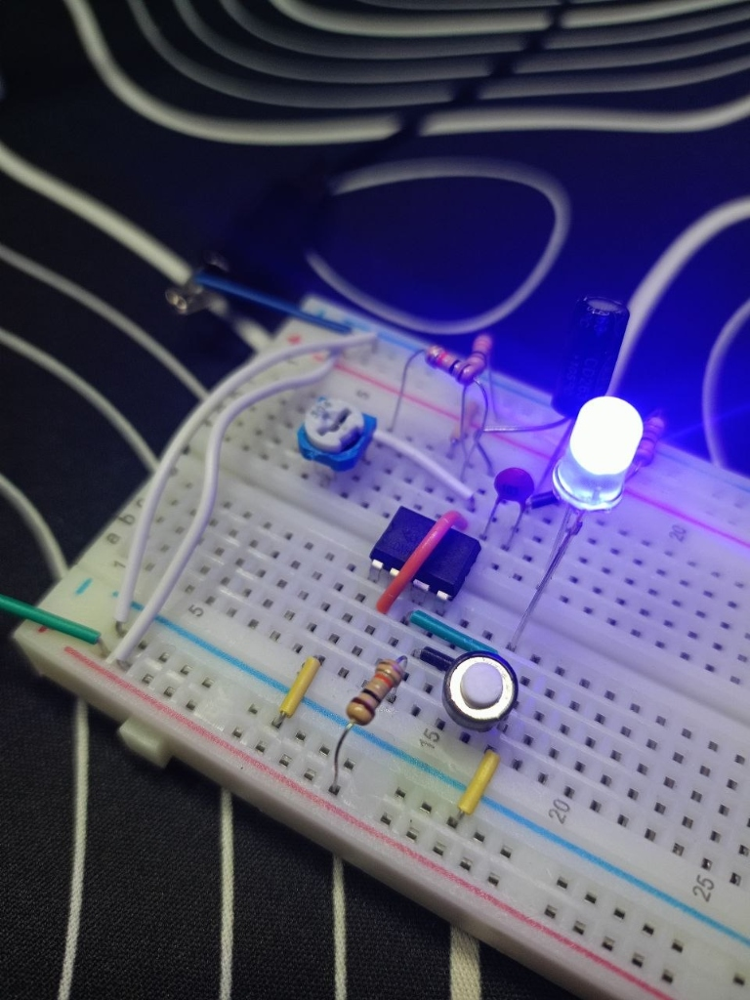
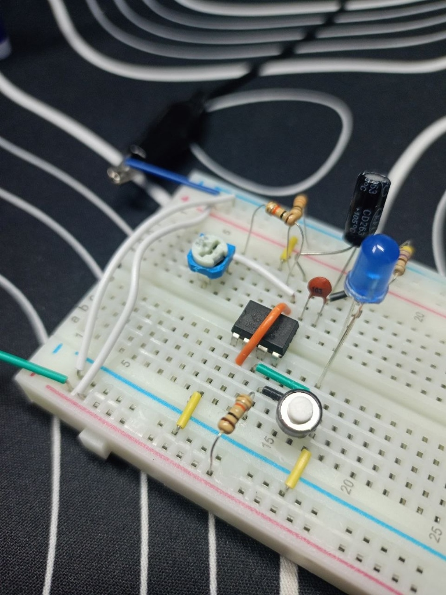

# 🚨 Project 01: Adjustable Strobe (NE555 Astable Multivibrator)

> Designing an autonomous square-wave pulse generator using the NE555 timer in astable mode with variable frequency control via potentiometer.

---

## 📋 Components Bill of Materials

| Component | Qty | Value / Specs |
| :--- | :---: | :--- |
| `IC Timer` | 1 | `NE555` (DIP-8) |
| `Trimmer Potentiometer` | 1 | `500 kΩ` (3362 type, code `504`) |
| `Electrolytic Capacitor` | 1 | `10 µF` (timing capacitor) |
| `Ceramic Capacitor` | 1 | `10 nF` (code `103`, Pin 5 decoupling) |
| `Resistor R1` | 1 | `10 kΩ` (Pin 7 pull-up & VCC short-circuit protection) |
| `Resistor R_protect` | 1 | `10 kΩ` (zero-ohm potentiometer limit guard) |
| `Current-limiting Resistor` | 1 | `220 Ω` (LED protection) |
| `LED` | 1 | Blue (or any color) |
| `Power Source` | 1 | `9V` Battery |
| `Prototyping Board` | 1 | Solderless Breadboard & jumper wires |

---

## ⚡ Circuit Theory & Operation

### 1. Monostable vs Astable Mode
* **Monostable:** Single-shot pulse triggered manually by external push-button.
* **Astable:** Free-running continuous oscillation. Self-triggers whenever capacitor voltage falls below $\frac{1}{3} V_{CC}$ and stops when reaching $\frac{2}{3} V_{CC}$.

### 2. Feedback Loop Architecture
Pins `2` (Trigger) and `6` (Threshold) are bridged together. They continuously monitor the voltage across the timing capacitor $C$:
* **$V_C < \frac{1}{3} V_{CC}$:** Lower comparator sets the internal RS latch $\implies$ Pin 3 goes `HIGH`, LED turns ON, internal discharge transistor (Pin 7) opens (switches OFF).
* **Capacitor charges:** Current flows from $+9V$ through $R_1 + R_{\text{pot}} + R_{\text{protect}}$ into capacitor $C$.
* **$V_C > \frac{2}{3} V_{CC}$:** Upper comparator resets the RS latch $\implies$ Pin 3 goes `LOW`, LED turns OFF, internal discharge transistor sinks Pin 7 to `GND`.
* **Capacitor discharges:** Charge from $C$ flows back through $R_{\text{pot}} + R_{\text{protect}}$ into Pin 7 to ground.
* **Cycle repeats indefinitely** as long as power is connected.

---

## 📸 Working Hardware Photos

### 1. Pulse Phase (LED ON):

### 2. Pause Phase (LED OFF):

---

## 🧠 Engineering Insights
> Bridging Pin 2 and Pin 6 forms a closed-loop negative feedback system. The potentiometer acts as a variable rheostat, tuning the RC time constant smoothly from slow pulses (~1 Hz) to high-speed strobe flashes (~50 Hz).
