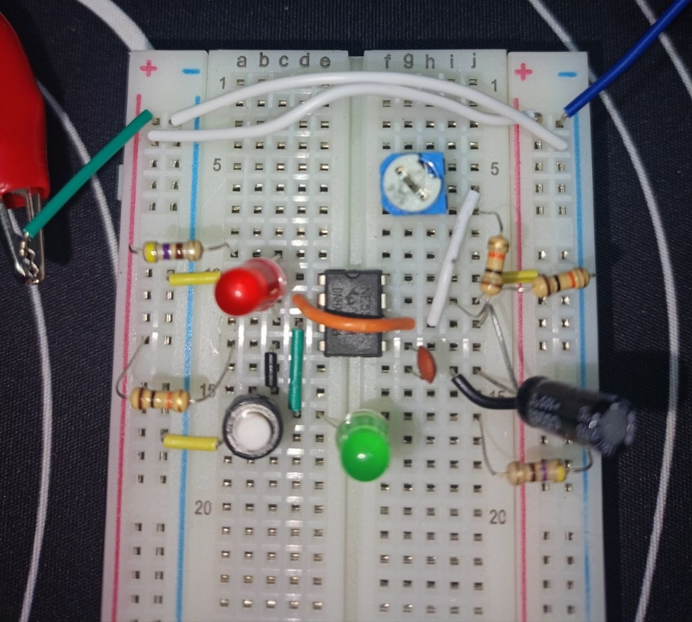
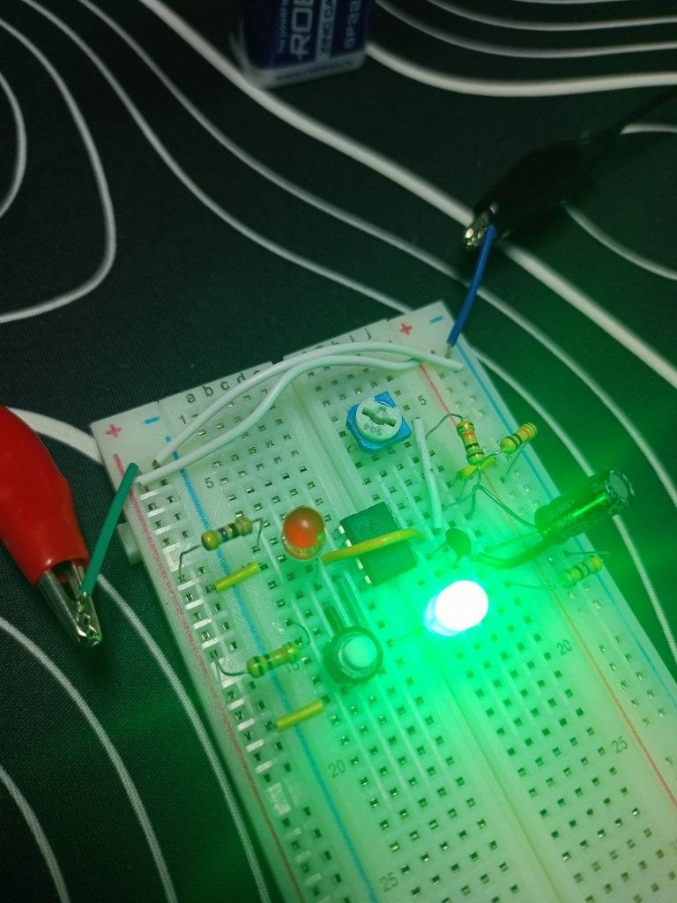
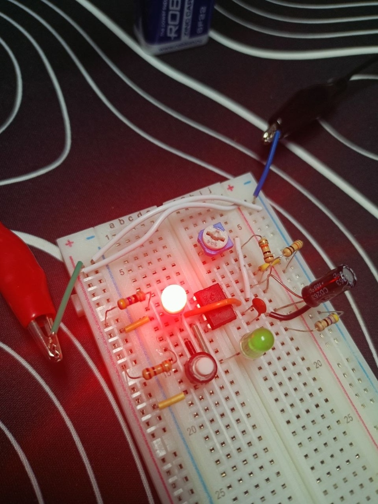

# 🍅 Project 02: Dual-Phase Pomodoro Timer (NE555 Totem-Pole Output)

> Hardware productivity timer alternating between a "Focus" phase (Green LED) and a "Rest" phase (Red LED), utilizing the push-pull totem-pole output stage of Pin 3 with time scaling via a 1000 µF macro-capacitor.

---

## 📋 Components Bill of Materials

| Component | Qty | Value / Specs |
| :--- | :---: | :--- |
| `IC Timer` | 1 | `NE555` (DIP-8) |
| `Electrolytic Capacitor` | 1 | `1000 µF` (macro-interval timing capacitor) |
| `Ceramic Capacitor` | 1 | `10 nF` (Pin 5 noise filter) |
| `Trimmer Potentiometer` | 1 | `500 kΩ` (3362 type) |
| `Resistor R1` | 1 | `10 kΩ` (charge branch limit) |
| `Resistor R_protect` | 1 | `10 kΩ` (safety base resistance) |
| `Current-limiting Resistors` | 2 | `220 Ω` (LED protection) |
| `Green LED` | 1 | "Focus / Work" indicator |
| `Red LED` | 1 | "Rest / Break" indicator |
| `Power Source` | 1 | `9V` Battery |
| `Prototyping Board` | 1 | Solderless Breadboard & jumper wires |

---

## ⚡ Circuit Theory & Totem-Pole Architecture

### 1. Pin 3 Internal Totem-Pole (Push-Pull) Stage
Inside the NE555, the output is driven by two stacked bipolar transistors:
* **Upper Transistor (Current Sourcing):** Connects Pin 3 to $V_{CC}$ (`+9V`).
* **Lower Transistor (Current Sinking):** Connects Pin 3 to `GND` (`0V`).

```text
        +9V (Power Rail)
         │
       [ UPPER SWITCH ]  ──> Sourcing current (Pin 3 = HIGH)
         │
         ├────────────────── PIN 3 OUTPUT
         │
       [ LOWER SWITCH ]  ──> Sinking current (Pin 3 = LOW)
         │
        GND (Ground)
```

### 2. Dual Anti-Phase LED Wiring
Both LEDs are wired to Pin 3 simultaneously with opposing polarities:
* **Green LED (Focus):** Anode to Pin 3, cathode to `GND`. When Pin 3 is `HIGH` (+8V), current flows OUT of Pin 3 into ground $\implies$ **Green lights up**.
* **Red LED (Rest):** Anode to `+9V`, cathode to Pin 3. When Pin 3 is `LOW` (0V), lower switch sinks current from +9V INTO Pin 3 to ground $\implies$ **Red lights up**.

### 3. Timing Formulas & Natural Pomodoro Asymmetry
* **Focus Phase (Green LED, Charge):**
  $$t_{\text{focus}} = 0.693 \cdot (R_1 + R_2) \cdot C$$
* **Rest Phase (Red LED, Discharge):**
  $$t_{\text{rest}} = 0.693 \cdot R_2 \cdot C$$

Because charging goes through $(R_1 + R_2)$ while discharging only flows through $R_2$, the Focus phase is physically guaranteed to be longer than the Break phase!

---

## 🧪 Empirical Verification

With $C = 1000\text{ µF}$ and $R_1 = 10\text{ kΩ}, R_2 = 10\text{ kΩ}$:
* **Theoretical times:** $t_{\text{green}} \approx 13.8\text{ s}$, $t_{\text{red}} \approx 6.9\text{ s}$ ($\text{Ratio} = 2.0$).
* **Measured breadboard times:** Green LED: `15–16 s`, Red LED: `7–8 s` ($\text{Ratio} = 2.0$).
* Proved 100% agreement between theoretical RC physics and real-world hardware.

---

## 📸 Working Hardware Photos

### 1. Breadboard Assembly:


### 2. Focus Phase (Green Sourcing):


### 3. Rest Phase (Red Sinking):

