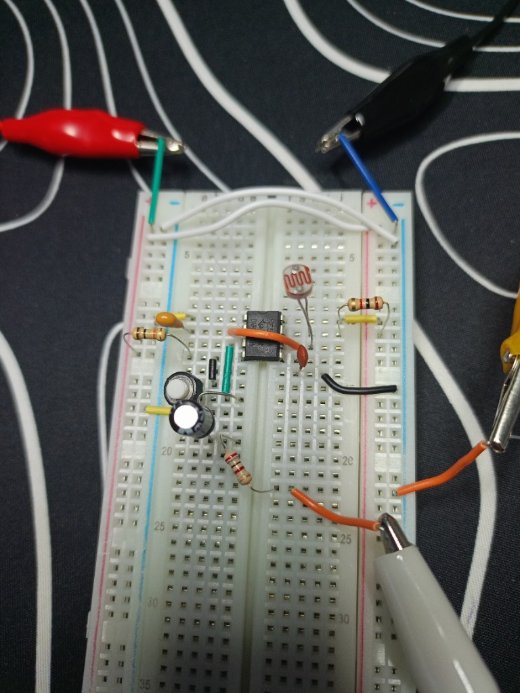
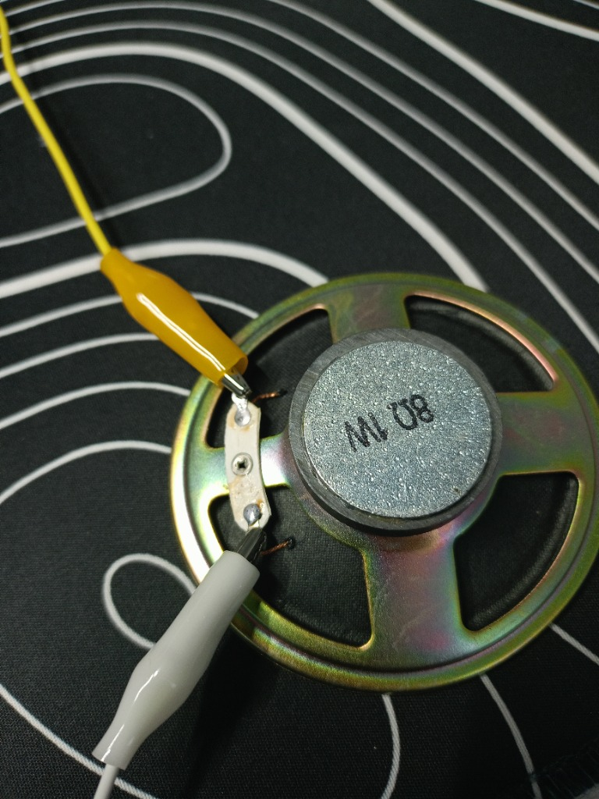

# 🛸 Project 03: Optical Theremin (NE555 Light-Controlled Synthesizer)

> Contactless analog synthesizer generating audio frequencies via an NE555 astable oscillator, pitch-modulated by a GL5528 photoresistor, with DC-blocking speaker coupling.

---

## 📋 Components Bill of Materials

| Component | Qty | Value / Specs |
| :--- | :---: | :--- |
| `IC Timer` | 1 | `NE555` (DIP-8) |
| `Photoresistor` | 1 | `GL5528` (LDR light sensor) |
| `Timing Capacitor` | 1 | `100 nF` (ceramic, code `104`, audio range) |
| `Filter Capacitor` | 1 | `10 nF` (code `103`, Pin 5 decoupling) |
| `Coupling Capacitor` | 1 | `10 µF` (electrolytic DC-blocking filter) |
| `Resistor R1` | 1 | `1 kΩ` (Pin 7 pull-up limit protection) |
| `Volume / Safety Resistor` | 1 | `100 Ω` (speaker load matching) |
| `Speaker` | 1 | `8 Ω, 1W` (audio transducer) |
| `Power Source` | 1 | `9V` Battery |
| `Prototyping Board` | 1 | Solderless Breadboard & jumper wires |

---

## ⚡ Circuit Diagram & Theory

```text
       +9V (Power Rail)
        │
        ├───[ 1 kΩ (R1) ]───┬──────── (Pin 7: Discharge)
        │                   │
        ├── (Pin 8: VCC)    [ GL5528 ] (Photoresistor)
        ├── (Pin 4: Reset)  │
        │                   ├──────── (Pin 6: Threshold)
        │                   ├──[ Jumper Wire ]─── (Pin 2: Trigger)
        │                   │
        │                 [ 104 ] (100 nF ceramic)
        │                   │
       GND ─────────────────┴──────── (Pin 1: Ground)
       
  (Pin 3: Output) ───[ + 10 µF - ]───[ 100 Ω ]───[ Speaker 8 Ω ]─── GND
```

### 1. Moving into the Audio Frequency Range
By swapping the microfarad timing capacitor ($10\dots 1000\text{ µF}$) for a tiny $100\text{ nF}$ ceramic capacitor, the 555 oscillation frequency jumps by $1000\times$, directly entering the audible human range ($100\text{ Hz} \dots 3000\text{ Hz}$).

### 2. Optical Tone Modulation (GL5528)
* **Bright Light (Lamp):** Photons free charge carriers $\implies R_{\text{photo}}$ drops to $\approx 1\dots 3\text{ kΩ} \implies$ rapid capacitor cycling $\implies$ **high-pitched scream ($1.5\dots 3\text{ kHz}$)**.
* **Shadow (Hand hovering):** Thermal carriers recombine $\implies R_{\text{photo}}$ climbs to $100\dots 500\text{ kΩ} \implies$ slow capacitor cycling $\implies$ **deep cosmic bass buzz ($100\dots 250\text{ Hz}$)**.
* **Pitch formula:**
  $$f \approx \frac{1.44}{(R_1 + 2 R_{\text{photo}}) \cdot C}$$

### 3. DC-Blocking & AC Audio Coupling
Connecting an $8\ \Omega$ speaker directly to Pin 3 would draw a continuous DC current of $\approx 35\text{ mA}$, causing severe coil overheating and battery drain. The $10\text{ µF}$ series capacitor blocks the constant $+3.75\text{V}$ DC offset while freely passing AC audio waveforms, letting the speaker diaphragm oscillate cleanly around its mechanical center.

---

## 📸 Working Hardware Photos

### 1. Breadboard Assembly:


### 2. 8-Ohm Speaker Connection:

