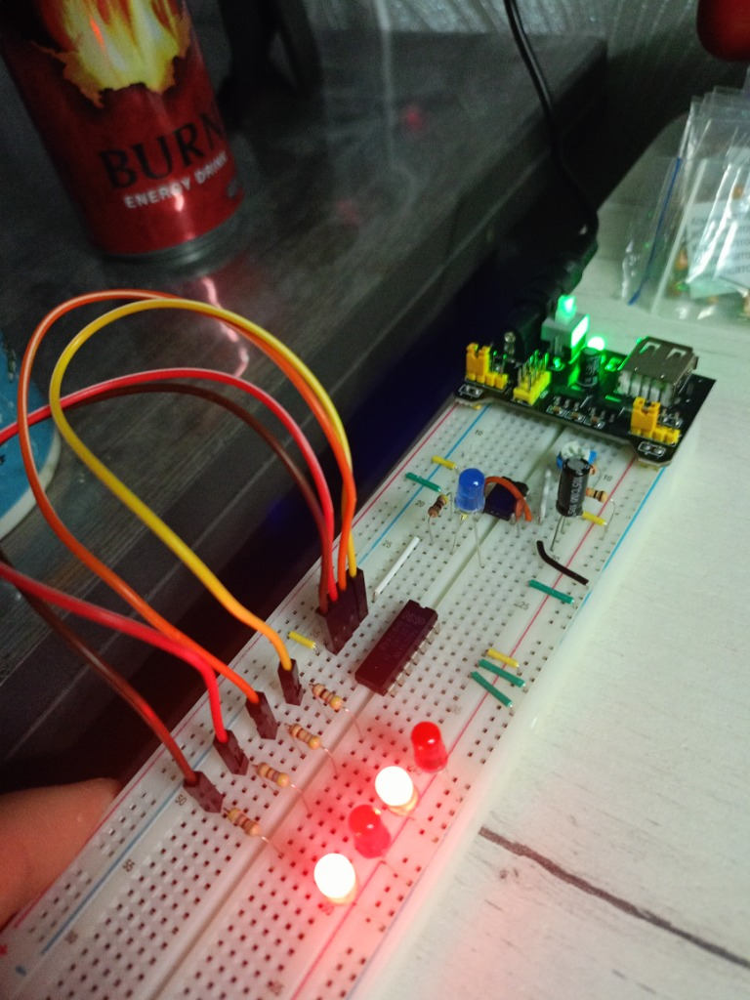
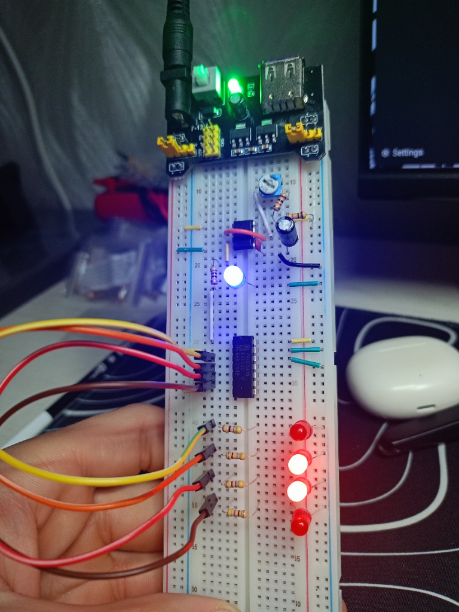

# 🔢 Project 04: 4-Bit Binary Computer Counter (NE555 + 74HC393)

> Interfacing an analog clock generator (NE555) with digital CMOS ripple counter logic (74HC393 dual 4-bit binary counter), demonstrating frequency division across 4 cascaded T-flip-flops and reading raw binary states from $0000_2$ to $1111_2$ (0 to 15).

---

## 📋 Components Bill of Materials

| Component | Qty | Value / Specs |
| :--- | :---: | :--- |
| `IC Timer` | 1 | `NE555` (DIP-8, master Clock source) |
| `Binary Counter IC` | 1 | `74HC393` (Dual 4-bit Binary Ripple Counter, DIP-14) |
| `Regulated Power Supply` | 1 | `MB102` (Breadboard supply, set to regulated `+5V` for 74HC logic) |
| `Clock Pulse LED` | 1 | Blue 5 mm (visual indicator of NE555 output) |
| `Binary Register LEDs` | 4 | Red 5 mm (Bit indicators: $Q_0, Q_1, Q_2, Q_3$) |
| `Current-limiting Resistors` | 5 | `220 Ω` (LED protection) |
| `Timing Resistor R1` | 1 | `10 kΩ` (Pin 7 pull-up limit protection) |
| `Timing Potentiometer` | 1 | `500 kΩ` (trimmer, variable clock speed tuning) |
| `Timing Capacitor` | 1 | `10 µF` (electrolytic, clock timing) |
| `Filter Capacitor` | 1 | `10 nF` (ceramic, code `103`, Pin 5 noise bypass) |
| `Prototyping Board` | 1 | Solderless Breadboard & solid-core jumper wires |
| `Power Adapter` | 1 | `9V` DC wall adapter (feeding MB102 module) |

---

## ⚡ Circuit Theory & Operation

### 1. Ripple Counter & T-Flip-Flop Architecture
The `74HC393` contains two independent 4-bit binary ripple counters. Each 4-bit stage consists of **4 cascaded Toggle (T) flip-flops**:
* The clock input ($1\overline{\text{CP}}$, Pin 1) triggers on the **negative (falling) edge** of the incoming pulse.
* The output of each flip-flop directly drives the clock input of the subsequent stage:
  $$\text{Clock} \longrightarrow T_0 (Q_0) \longrightarrow T_1 (Q_1) \longrightarrow T_2 (Q_2) \longrightarrow T_3 (Q_3)$$

### 2. Frequency Division Logic
Every flip-flop divides the frequency of its incoming clock signal by exactly **2**:
* **$Q_0$ (Bit 0, LSB):** Toggles on every clock cycle $\implies f_0 = \frac{f_{\text{clk}}}{2}$
* **$Q_1$ (Bit 1):** Toggles every time $Q_0$ falls from HIGH to LOW $\implies f_1 = \frac{f_{\text{clk}}}{4}$
* **$Q_2$ (Bit 2):** Toggles every time $Q_1$ falls $\implies f_2 = \frac{f_{\text{clk}}}{8}$
* **$Q_3$ (Bit 3, MSB):** Toggles every time $Q_2$ falls $\implies f_3 = \frac{f_{\text{clk}}}{16}$

### 3. Binary to Decimal Truth Table ($0 \dots 15$)

| Decimal | $Q_3\ (2^3 = 8)$ | $Q_2\ (2^2 = 4)$ | $Q_1\ (2^1 = 2)$ | $Q_0\ (2^0 = 1)$ | 4-Bit Binary Word |
| :---: | :---: | :---: | :---: | :---: | :---: |
| **0** | `0` (OFF) | `0` (OFF) | `0` (OFF) | `0` (OFF) | `0000` |
| **1** | `0` | `0` | `0` | `1` (ON) | `0001` |
| **2** | `0` | `0` | `1` | `0` | `0010` |
| **3** | `0` | `0` | `1` | `1` | `0011` |
| **4** | `0` | `1` | `0` | `0` | `0100` |
| **...** | ... | ... | ... | ... | ... |
| **14** | `1` | `1` | `1` | `0` | `1110` |
| **15** | `1` (ON) | `1` (ON) | `1` (ON) | `1` (ON) | `1111` |

On the 16th clock pulse, the register overflows and rolls back to `0000`, continuously cycling.

### 4. Master Reset (MR / 1MR)
Pin 2 ($1\text{MR}$) resets the first counter stage back to `0000` when driven HIGH. For uninterrupted counting, Pin 2 is tied directly to `GND`.

---

## 📸 Working Hardware Photos

### 1. Circuit Layout & 4-Bit LED Register (Isometric View):

### 2. Operational Frontal View:

---

## 🧠 Engineering Insights
> * **Asynchronous Ripple Propagation:** Because each flip-flop is clocked by the preceding one, a minuscule propagation delay ($\approx 15\text{ ns}$ per stage) ripples down the chain. While negligible at 1 Hz, in gigahertz processors synchronous counters (where all flip-flops share a common clock line) are required to avoid glitch states.
> * **Logic Family Voltage Matching:** The high-speed CMOS `74HC` family is designed for $2\text{V} - 6\text{V}$ operation. Supplying the circuit through the `MB102` set to strictly regulated $+5\text{V}$ ensures compatibility with both standard 5V digital logic and the NE555 timer.
