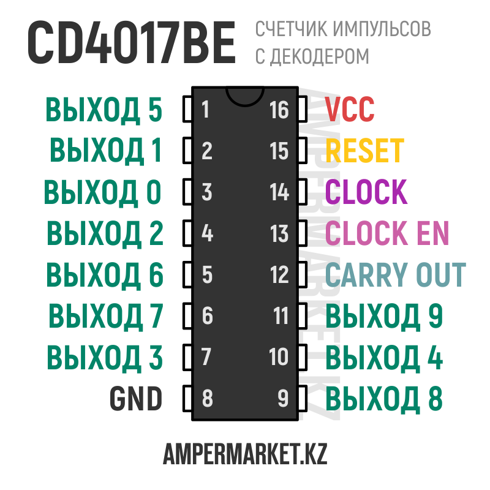
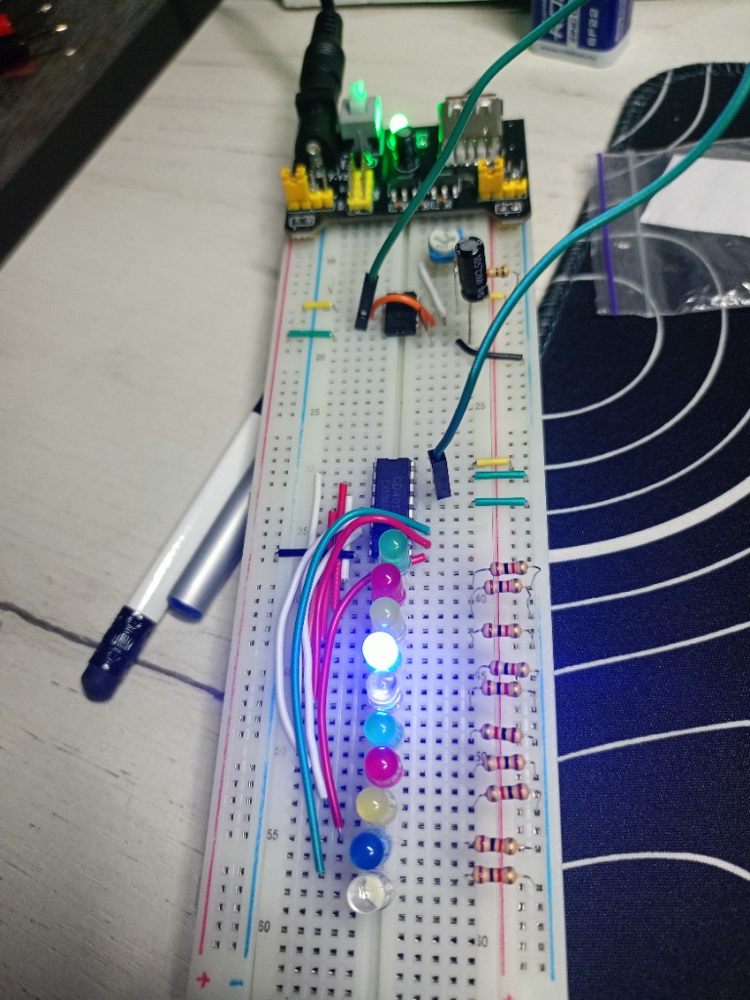
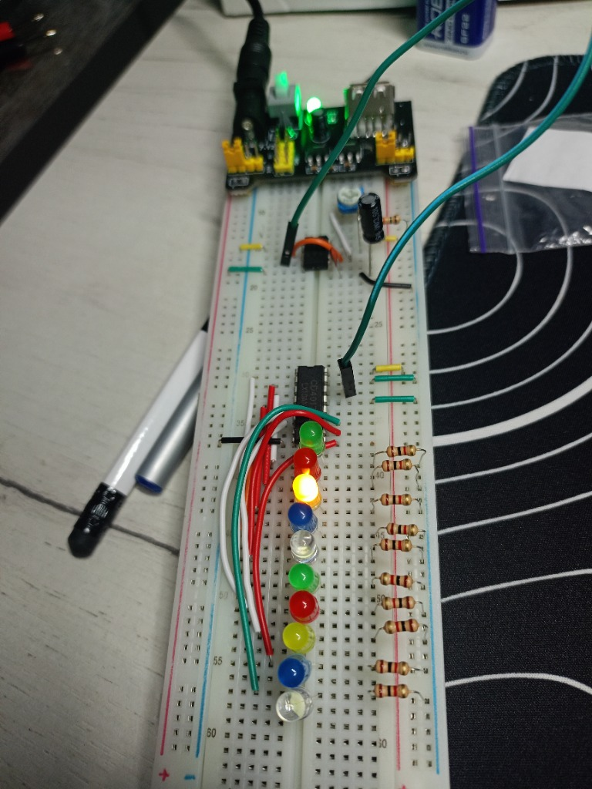

# 🚨 Project 05: Decade LED Chaser / Running Lights (NE555 + CD4017BE)

> Synchronized decade pulse distributor utilizing an NE555 clock generator and a CD4017BE CMOS Johnson counter, cascading 10 LEDs in a sequential traveling wave with frequency tuning and flat solid-core wire routing.

---

## 📋 Components Bill of Materials

| Component | Qty | Value / Specs |
| :--- | :---: | :--- |
| `IC Timer` | 1 | `NE555` (DIP-8, master Clock source) |
| `Decade Counter / Divider` | 1 | `CD4017BE` (5-stage Johnson decade counter with 10 decoded outputs, DIP-16) |
| `Regulated Power Supply` | 1 | `MB102` (Breadboard supply, regulated `+5V` DC) |
| `Display LEDs` | 10 | `5 mm` (Green, Red, Yellow, Blue, White) |
| `Current-limiting Resistors` | 10 | `220 Ω` / `470 Ω` (individual cathode-to-GND protection) |
| `Timing Resistor R1` | 1 | `10 kΩ` (Pin 7 pull-up limit protection) |
| `Protection Resistor R2` | 1 | `1 kΩ` (series safety limit for timing branch) |
| `Timing Potentiometer` | 1 | `500 kΩ` (trimmer, variable wave speed control) |
| `Timing Capacitor` | 1 | `10 µF` (electrolytic, oscillation timing) |
| `Filter Capacitor` | 1 | `10 nF` (ceramic, code `103`, Pin 5 noise bypass) |
| `Prototyping Board` | 1 | Solderless Breadboard & custom-bent solid copper jumpers |
| `Power Adapter` | 1 | `9V` DC wall adapter (feeding MB102) |

---

## 📌 CD4017BE Pinout Reference (DIP-16)

### Pin Functionality Overview:
* **`CLK` (Pin 14):** Clock input. Advances the active output to the next consecutive stage on every **rising (positive) edge** from the NE555 timer.
* **`CLOCK ENABLE` / `CLK INHIBIT` (Pin 13):** Active-low clock gate. Must be tied to **`GND`** for free-running continuous counting. If left floating or driven HIGH, counting freezes.
* **`RESET` (Pin 15):** Asynchronous master reset. Forces active output back to $Q_0$ when HIGH. Must be tied to **`GND`** for uninterrupted 10-step cycles.
* **`CARRY OUT` (Pin 12):** Outputs a symmetric square wave ($50\%$ duty cycle) with $f = \frac{f_{\text{clk}}}{10}$ (HIGH during counts $0..4$, LOW during $5..9$), used to clock subsequent counter stages in multi-digit systems.

---

## ⚡ Circuit Theory & Operation

### 1. Johnson Counter Architecture & 1-of-10 Decoding
The `CD4017BE` is built around a 5-stage synchronous shift register with inverted feedback (Johnson counter). Internal logic gates continuously decode the 5 register states into **10 mutually exclusive active-high outputs** ($Q_0 \dots Q_9$):
$$\text{At any single instant, exactly ONE output is HIGH (+5V), while the other 9 outputs are actively pulled to GND (0V).}$$

### 2. Sequential Wave Cycle
$$\text{LED 1 } (Q_0) \longrightarrow \text{LED 2 } (Q_1) \longrightarrow \text{LED 3 } (Q_2) \longrightarrow \dots \longrightarrow \text{LED 10 } (Q_9) \longrightarrow \text{LED 1 } (Q_0)$$

---

## 🔌 LED Physical Mapping Table

Because of silicon die topology, the decoded outputs $Q_0 \dots Q_9$ are distributed non-linearly across the DIP-16 package. The 10-LED linear bar was connected following this routing map:

| LED Bar Position | Logical Output | Physical Pin (CD4017BE) | Package Location |
| :---: | :---: | :---: | :---: |
| **LED 1** | $Q_0$ | **Pin 3** | Left side |
| **LED 2** | $Q_1$ | **Pin 2** | Left side |
| **LED 3** | $Q_2$ | **Pin 4** | Left side |
| **LED 4** | $Q_3$ | **Pin 7** | Left side |
| **LED 5** | $Q_4$ | **Pin 10** | Right side |
| **LED 6** | $Q_5$ | **Pin 1** | Left side |
| **LED 7** | $Q_6$ | **Pin 5** | Left side |
| **LED 8** | $Q_7$ | **Pin 6** | Left side |
| **LED 9** | $Q_8$ | **Pin 9** | Right side |
| **LED 10** | $Q_9$ | **Pin 11** | Right side |

---

## 📸 Working Hardware Photos

### 1. Blue LED Phase (Custom Solid-Core Jumpers Layout):

### 2. Yellow LED Phase:

---

## 🧠 Engineering Insights
> * **The DIP Pinout Trap:** In standard DIP packages, pin numbering follows a counter-clockwise **U-shape**: left side counts down ($1 \to 8$), while right side counts **bottom-up** ($9 \to 16$). Assuming the right side numbers top-down will flip pins 10 and 15, causing erratic resets or inactive outputs.
> * **Breadboard Hygiene & Signal Integrity:** Flexible stranded Dupont jumpers create a tall "wire nest" that easily snags, blocks component labels, and introduces intermittent contact resistance. Replacing them with custom-bent, flat-lying solid-core copper jumpers eliminates contact bounce, provides a clear view of IC pins, and turns the breadboard into a neat planar data bus.
