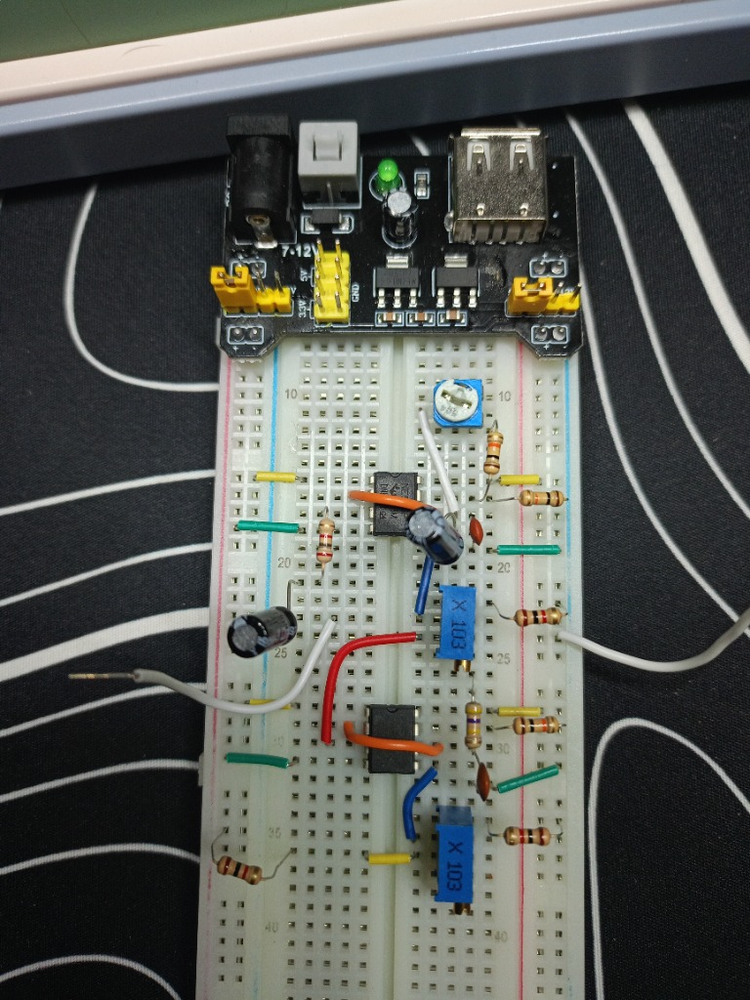
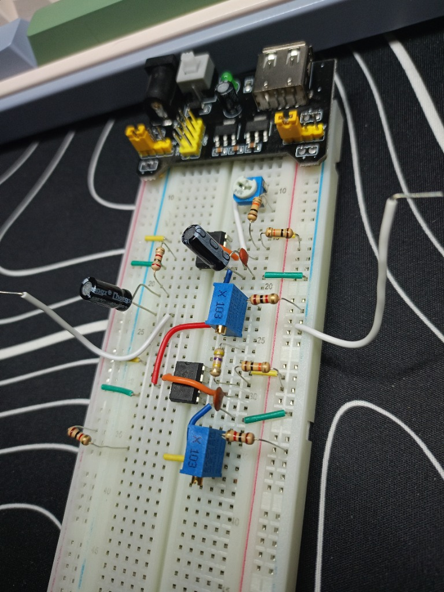

# 🚨 Project 06: Two-Tone Police Siren (Dual NE555 Frequency Modulation)

> Cascaded dual-timer analog synthesizer demonstrating hardware **Frequency Modulation (FM)**. A low-frequency oscillator (LFO) modulates the internal comparator threshold (Pin 5 Control Voltage) of an audio-rate oscillator (VCO), driving an alternating "wee-woo" police siren through an AC-coupled 8Ω speaker.

---

## 📋 Components Bill of Materials

| Component | Qty | Value / Specs |
| :--- | :---: | :--- |
| `IC Timers` | 2 | `NE555P` (DIP-8, LFO Modulator + Audio VCO) |
| `Regulated Power Supply` | 1 | `MB102` (Breadboard supply, regulated `+5V` DC) |
| `Audio Transducer` | 1 | `8 Ω, 0.5W` (dynamic speaker) |
| `AC Coupling Capacitor` | 1 | `100 µF` (electrolytic, DC-blocking audio output) |
| `LFO Timing Capacitor` | 1 | `10 µF` (electrolytic, slow $1\dots 4\text{ Hz}$ warble rate) |
| `Audio Timing Capacitor` | 1 | `10 nF` (ceramic, code `103`, $\approx 1000\text{ Hz}$ tone) |
| `Pitch Potentiometer` | 1 | `500 kΩ` (trimmer, audio center-frequency adjustment) |
| `Modulation / Volume Pots`| 2 | `10 kΩ` (multi-turn `3296W`, FM depth and speaker volume) |
| `Ballast Resistor` | 1 | `100 Ω` (speaker current limiter) |
| `Timing Pull-up Resistors`| 2 | `10 kΩ` (Pin 7 discharge protection) |
| `Protection Resistor` | 1 | `1 kΩ` (volume potentiometer safety limit) |
| `Prototyping Board` | 1 | Solderless Breadboard & jumper wires |

---

## ⚡ Circuit Architecture & Modulation Theory

```text
  [ BOTTOM NE555: LFO ]                         [ TOP NE555: Audio VCO ]
   C = 10 µF (Slow 1–4 Hz)                       C = 10 nF (Audio ~1000 Hz)
            │                                             │
      (Pin 3: Output)                              (Pin 5: Control Voltage)
            │                                             ▲
            └───► [ 10 kΩ FM Depth Pot ] ─────────────────┘
                     (Attenuator)                         │
                                                   (Pin 3: Audio Out)
                                                          │
                                               [ 100 µF AC Capacitor ]
                                                          │
                                                    [ 100 Ω Resistor ]
                                                          │
                                                   [ Speaker 8 Ω ] ──► GND
```

### 1. Unlocking Pin 5: The Internal Comparator Threshold
Inside every 555 timer, a precision resistor ladder of three $5\text{ kΩ}$ resistors establishes two internal reference points:
* Lower trigger comparator: $\frac{1}{3} V_{cc}$ (initiates charge).
* Upper threshold comparator: $\frac{2}{3} V_{cc}$ (initiates discharge).

Pin 5 connects **directly to the $\frac{2}{3} V_{cc}$ tap**. In standard circuits, it is decoupled to ground with a $10\text{ nF}$ capacitor. In this project, Pin 5 is actively manipulated as an external control input:
* **Higher Voltage at Pin 5 ($\uparrow$):** The upper threshold rises $\implies$ timing capacitor takes longer to reach the cutoff $\implies$ **frequency drops (deep bass tone)**.
* **Lower Voltage at Pin 5 ($\downarrow$):** The upper threshold drops $\implies$ timing capacitor triggers in microseconds $\implies$ **frequency soars (shrill treble tone)**.

### 2. Dual-Timer Cascaded Frequency Modulation (FM)
1. **LFO Stage (Bottom 555):** Configured as a slow astable multivibrator cycling between $+V_{cc}$ and $0\text{V}$ at $1\dots 4\text{ Hz}$.
2. **Attenuator Stage (Middle Potentiometer):** Acts as a variable voltage divider, scaling the pulse amplitude before feeding it to Pin 5.
3. **Audio VCO Stage (Top 555):** Free-runs at $\approx 1000\text{ Hz}$. As the LFO shifts its reference threshold, the top timer dynamically alternates between high and low pitch: **"WEE — WOO — WEE — WOO"**.

### 3. DC-Blocking & Speaker Protection (`AC Coupling`)
An $8\ \Omega$ speaker voice coil has nearly zero DC resistance. Connecting it directly to a 555 totem-pole output would pass continuous DC current, causing thermal runaway and voice coil burnout. The $100\text{ µF}$ series electrolytic capacitor blocks the steady DC bias while allowing alternating audio waveforms to oscillate the speaker cone.

---

## 📸 Working Hardware Photos

### 1. Top-Down Layout:
Dual NE555 ICs, multi-turn 3296W trimmers, and output stage with MB102 power regulator:


### 2. Perspective View:
Detailed wiring layout showing Pin 3 to Pin 5 modulation routing:


---

## 🛠️ Engineering Debugging Log (Troubleshooting Insights)

| Issue Observed | Root Cause | Engineering Solution |
| :--- | :--- | :--- |
| **Steady, monotone whine** (no two-tone warble) | Both timing capacitors were small ceramic values (`103` = 10 nF and `473` = 47 nF). The LFO was switching 500 times/sec, blurring into an inseparable high-frequency audio tone. | Replaced LFO capacitor with a $10\text{ µF}$ electrolytic to lower switching frequency to human-audible $1\dots 2\text{ Hz}$. |
| **Rhythmic clicking instead of siren** (`click... click...`) | A $10\text{ µF}$ capacitor was erroneously placed on the audio timer driving the speaker. The audio carrier dropped to $1\text{ Hz}$, generating single mechanical cone displacements instead of sound waves. | Swapped capacitors: $10\text{ nF}$ (`103`) strictly for the audio carrier (Top IC), $10\text{ µF}$ for the LFO modulator (Bottom IC). |
| **Missing modulation signal** | The jumper wire from the middle potentiometer was incorrectly grounded into Pin 1 instead of Pin 5. | Re-routed the modulation jumper directly to Pin 5 (Control Voltage) of the carrier timer. |
