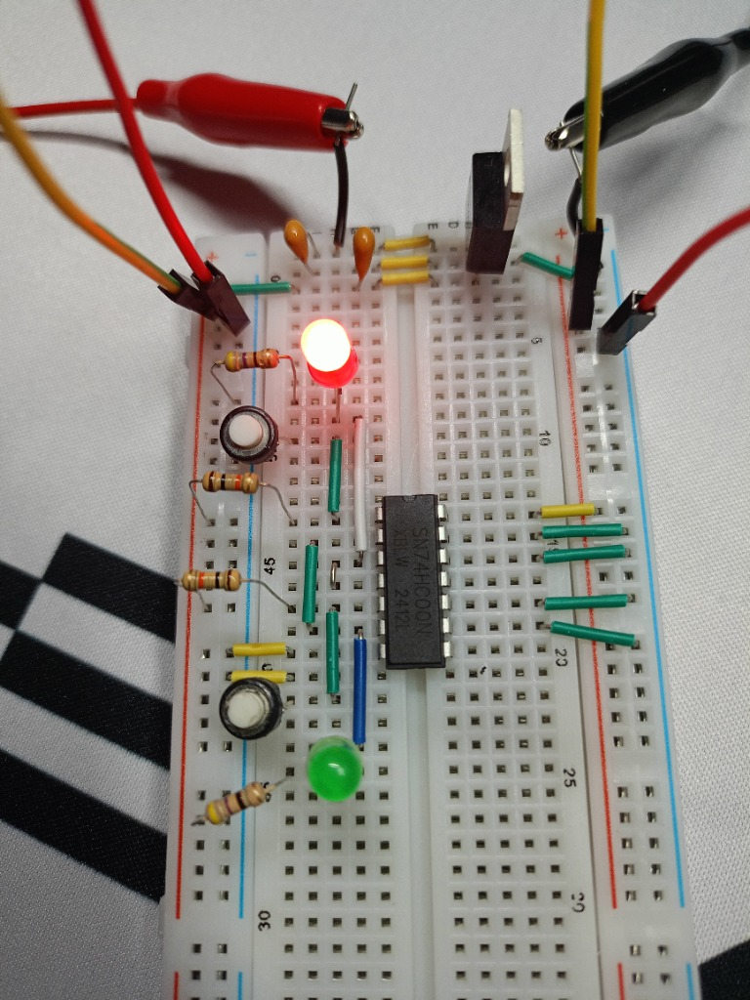
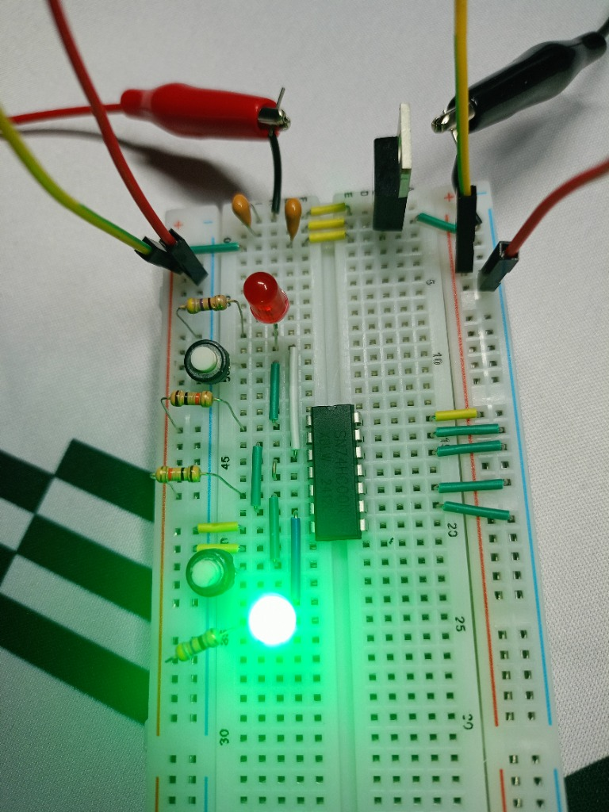

# 💾 Project 07: 1-Bit Static RAM Cell (Active-LOW RS-Latch on 74HC00 & 7805)

> Discrete digital memory cell demonstrating asynchronous sequential logic and bistable multivibrator principles. Built using cross-coupled NAND gates (`SN74HC00N`) with an autonomous linear voltage regulator (`L7805CV`), active-LOW ground-switched triggering, input/output decoupling network, and grounded unused CMOS gates to prevent parasitic oscillation.

---

## 📋 Components Bill of Materials

| Component | Qty | Value / Specs | Purpose |
| :--- | :---: | :--- | :--- |
| `Logic IC` | 1 | `SN74HC00N` (DIP-14) | Quad 2-input NAND gates (High-Speed CMOS) |
| `Linear Voltage Regulator` | 1 | `L7805CV` (TO-220) | Regulates raw $+9\text{V}$ battery to stable $+5.0\text{V}$ |
| `Input Decoupling Capacitor` | 1 | `0.47 µF` (ceramic code `474`) | Compensates battery lead inductance / local energy buffer |
| `Output Decoupling Capacitor`| 1 | `0.1 µF` (ceramic code `104`) | Suppresses high-frequency feedback self-oscillation |
| `Tactile Pushbuttons` | 2 | 4-pin momentary switches | `SET` (Pin 1) and `RESET` (Pin 5) manual inputs |
| `Pull-up Resistors` | 2 | `10 kΩ`, 0.25W | Holds idle input pins securely at logic `1` (+5V) |
| `LED Ballast Resistors` | 2 | `330 Ω` – `470 Ω`, 0.25W | Current limiters for indicator LEDs ($\approx 10\text{ mA}$) |
| `Indicator LEDs` | 2 | 5mm (Red: $Q$, Green: $\overline{Q}$) | Direct visual feedback of stored memory bit |
| `Primary Power Source` | 1 | 9V PP3 Alkaline Battery | Autonomous DC source for Board 2 |
| `Prototyping Platform` | 1 | Solderless Breadboard `MB-102` | Isolated planar prototype layout |

---

## ⚡ Circuit Architecture & Logic Diagram

```text
               +5V Regulated (7805)
                │
         [ 10 kΩ Pull-up ]
                ├─── (Pin 1: Input A) ───┐
  [ SET Button ]                         │
  (to GND)                               ▼
                                  +--------------+
                                  | NAND Gate 1  |── (Pin 3: Q) ──► [ Red LED ]
                               ┌──| (Pins 1, 2)  |      │
                               │  +--------------+      │
                               │         ▲              │
                 Feedback Loop │         │              │ Feedback Loop
                 (Pin 6 -> 2)  │         └──────────────┼──────────────┐
                               │                        │              │
                               │  +--------------+      │              │
                               │  | NAND Gate 2  |      ▼              │
  [ RESET Button ]             └──| (Pins 4, 5)  |── (Pin 6: /Q) ──► [ Green LED ]
  (to GND)                        +--------------+      │
                ├─── (Pin 5: Input B) ───┘              │
         [ 10 kΩ Pull-up ]                              └──────────────┘
                │
               +5V Regulated
```

### 1. NAND Gate Dominance & Active-LOW Triggering
The truth table of a 2-input NAND gate ($Y = \overline{A \cdot B}$) reveals why buttons must switch to **Ground ($GND$)**:

| Input A | Input B | Output $Y$ | Significance |
| :---: | :---: | :---: | :--- |
| `0` | `0` | **`1`** | Any `0` forces output HIGH |
| `0` | `1` | **`1`** | Any `0` forces output HIGH |
| `1` | `0` | **`1`** | Any `0` forces output HIGH |
| **`1`** | **`1`** | **`0`** | **Both inputs must be `1` to produce `0`** |

Because **`0` is the dominant active signal**, the circuit defaults to idle `1` via $10\text{ kΩ}$ pull-up resistors to $+5\text{V}$. Pressing a button bridges the input directly to $GND$, asserting an active `0` that unconditionally forces the respective gate output to `1`.

---

## 🔬 Power Rail Architecture: L7805CV Decoupling

High-Speed CMOS (`74HC`) logic gates break down if $V_{cc}$ exceeds $+6.0\text{V}$. The `L7805CV` linear regulator provides safe, stable $+5.0\text{V}$ from a $9\text{V}$ battery with two mandatory capacitors:

```text
  Raw +9V Battery In ───┬───────────────────[ L7805CV ]──────────────────┬─── +5.0V Regulated Out
                        │                      Pin 2                     │
                 [ 0.47 µF (474) ]            (Common)            [ 0.1 µF (104) ]
                        │                        │                       │
  GND Rail ─────────────┴────────────────────────┴───────────────────────┴─── GND Rail
```

1. **Input Capacitor `474` ($0.47\text{ µF}$):**  
   Compensates for the parasitic inductance and resistance of battery leads and clip wires. Acts as an instantaneous local energy reservoir during sharp transient current steps.
2. **Output Capacitor `104` ($0.1\text{ µF}$):**  
   Prevents high-frequency closed-loop phase-shift oscillations (MHz ringing) in the internal error amplifier of the 7805. Must be mounted as close to the output and ground terminals as possible.

---

## 🛡️ CMOS Protection: Terminating Floating Inputs

The `74HC00` contains 4 internal NAND gates. Gates 1 and 2 form the bistable latch. Gates 3 and 4 remain unused.  
* **Hazard:** Leaving CMOS inputs floating allows their ultra-high-impedance MOSFET gates to act as capacitive antennas, picking up stray RF fields. This drives the input into the linear transition zone, turning on both the P-channel and N-channel output transistors simultaneously (creating a destructive short-circuit "shoot-through" current between $+5\text{V}$ and $GND$).
* **Implementation:** Unused input pins **9, 10, 12, and 13** are tied directly to the **$GND$** rail. Unused outputs (pins 8 and 11) are left strictly disconnected.

---

## 📸 Working Hardware Photos

### 1. State $Q = 1$ (Red LED Active, SET Bit Stored)
The top section features the TO-220 `L7805CV` regulator with ceramic decoupling capacitors `474` and `104`. Extended jumper routing separates user buttons from sensitive IC pins:


### 2. State $\overline{Q} = 1$ (Green LED Active, RESET Bit Stored)
Upon pressing the `RESET` button, active-low ground injection flips the cross-coupled gates into the complementary state, locking the green LED permanently on:


---

## 🛠️ Practical Engineering Notes & Debugging

1. **Ergonomic Breadboard Partitioning:**  
   Placing tactile buttons immediately adjacent to the IC resulted in cramped finger access that mechanically disturbed indicator LEDs and pull-up resistors. Relocating buttons to the board periphery via color-coded jumpers solved mechanical congestion and improved circuit visibility.
2. **Pre-Power Verification:**  
   Before inserting the `74HC00` chip, the regulator output rail was verified with a digital multimeter under load: $+5.01\text{V}$ DC was confirmed across the main power bus, ensuring safe operation within the $2.0\text{V} \dots 6.0\text{V}$ operating window of the 74HC family.
3. **Forbidden State Avoidance:**  
   Pressing both `SET` and `RESET` simultaneously forces both outputs to `1` ($Q = \overline{Q} = 1$), violating the complementary definition of a latch. Upon releasing both buttons simultaneously, unpredictable propagation delay variations determine which state wins (race condition).
