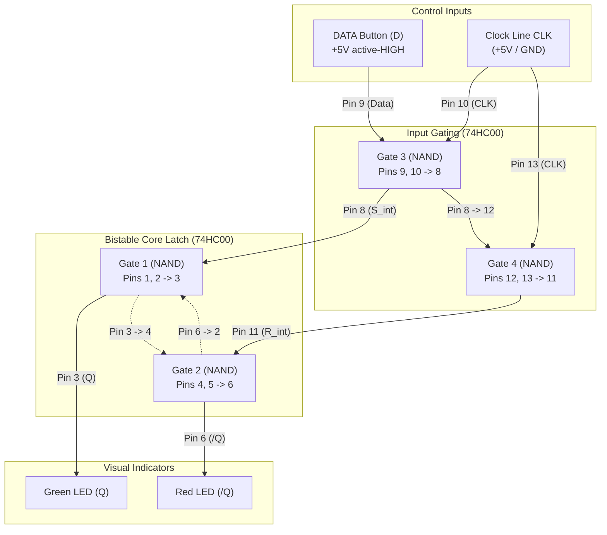
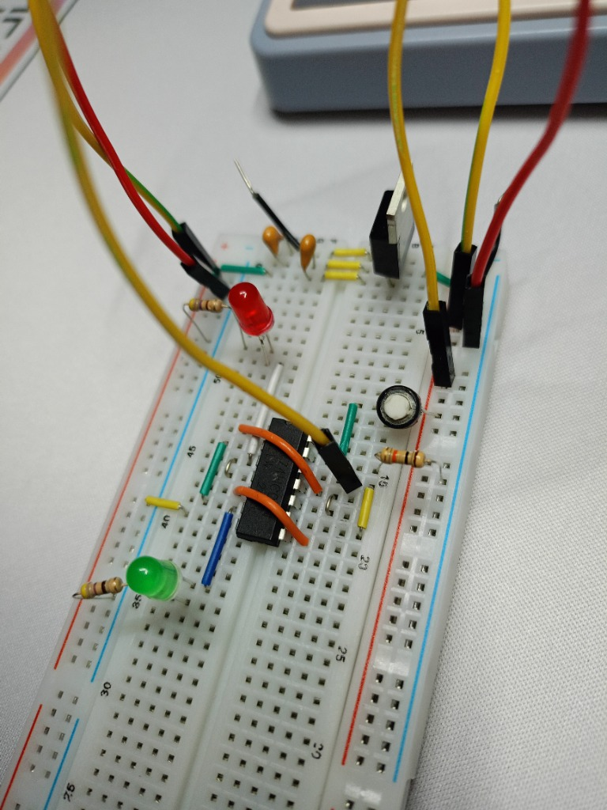
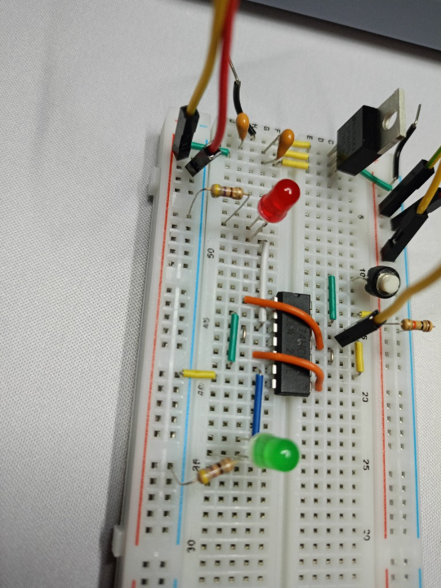

# 💾 Project 08: Synchronous D-Latch (1-Bit Gated Static RAM on 74HC00 & 7805)

> Synchronous 1-bit memory cell (Data Latch) implementing level-triggered gated storage using all four NAND gates of an `SN74HC00N` CMOS IC and an autonomous `L7805CV` (+5V) linear voltage regulator. Demonstrates single-line data control ($D$), hardware race-condition elimination, transparent write gating ($\text{CLK} = 1$), and zero-leakage static data hold ($\text{CLK} = 0$).

---

## 📋 Components Bill of Materials

| Component | Qty | Value / Specs | Purpose |
| :--- | :---: | :--- | :--- |
| `Logic IC` | 1 | `SN74HC00N` (DIP-14) | Quad 2-input NAND gates (High-Speed CMOS) |
| `Linear Voltage Regulator` | 1 | `L7805CV` (TO-220) | Regulates raw $+9\text{V}$ battery to stable $+5.0\text{V}$ |
| `Input Decoupling Capacitor` | 1 | `0.47 µF` (ceramic code `474`) | Compensates battery lead inductance / local energy reservoir |
| `Output Decoupling Capacitor`| 1 | `0.1 µF` (ceramic code `104`) | Suppresses high-frequency feedback self-oscillation |
| `Data Input Button` | 1 | 4-pin tactile switch | Active-HIGH Data line ($D$) input |
| `Pull-down Resistor` | 1 | `10 kΩ`, 0.25W | Holds idle $D$ input pin securely at logic `0` (GND) |
| `LED Ballast Resistors` | 2 | `330 Ω` – `470 Ω`, 0.25W | Current limiters for indicator LEDs ($\approx 10\text{ mA}$) |
| `Indicator LEDs` | 2 | 5mm (Green: $Q$, Red: $\overline{Q}$) | Direct visual feedback of stored memory bit |
| `Primary Power Source` | 1 | 9V PP3 Alkaline Battery | Autonomous DC source |
| `Prototyping Platform` | 1 | Solderless Breadboard `MB-102` | Planar prototype layout |

---

## ⚡ Circuit Architecture & Logic Diagram

In contrast to an RS-latch where separate SET and RESET lines exist (with the hazard of an invalid state $S=R=1$), the **D-Latch** uses a single data wire $D$ and a clock/enable line $\text{CLK}$. The invalid state is physically eliminated because the complementary inputs to the core latch are generated automatically through gate inversion.

### Pinout Mapping (`SN74HC00N`):
* **Core Latch:**
  * Gate 1 (Pins 1, 2 $\to$ 3): Output $Q$ on Pin 3 (Green LED). Input 2 loops to Pin 6.
  * Gate 2 (Pins 4, 5 $\to$ 6): Output $\overline{Q}$ on Pin 6 (Red LED). Input 4 loops to Pin 3.
* **Gating & Inverter Stages:**
  * Gate 3 (Pins 9, 10 $\to$ 8): Input 9 is $D$ (Button), Input 10 is $\text{CLK}$. Output 8 drives Pin 1 (Gate 1) and Pin 12 (Gate 4).
  * Gate 4 (Pins 12, 13 $\to$ 11): Input 12 receives Gate 3 Output (Pin 8), Input 13 is $\text{CLK}$. Output 11 drives Pin 5 (Gate 2).

---

## 🔬 Truth Table & Operating Modes

| $\text{CLK}$ (Clock) | $D$ (Data) | Gate 3 Out | Gate 4 Out | $Q$ (Green) | $\overline{Q}$ (Red) | Operating Mode |
| :---: | :---: | :---: | :---: | :---: | :---: | :--- |
| **`0`** | `X` (Any) | `1` | `1` | $Q_{prev}$ | $\overline{Q}_{prev}$ | **LATCH / HOLD (Memory frozen, ignores D)** |
| **`1`** | **`0`** | `1` | `0` | **`0`** | **`1`** | **TRANSPARENT: Write `0` (Reset)** |
| **`1`** | **`1`** | `0` | `1` | **`1`** | **`0`** | **TRANSPARENT: Write `1` (Set)** |

---

## 📸 Working Hardware Photos

### Oblique View (Breadboard Layout & Active Storage):

### Top-Down View (Wiring & Single Data Button Interface):

---

## 🛠️ Verification & Edge Testing

The circuit was verified across all operational boundaries:
1. **Transparent Mode ($\text{CLK} = 1$):** Pressing and releasing the $D$ button instantly and synchronously toggles the output LEDs ($D=1 \implies \text{Green ON}$; $D=0 \implies \text{Red ON}$).
2. **Hold Verification ($\text{CLK} = 0$):** Grounding the $\text{CLK}$ line completely freezes the output state. Subsequent toggles of the $D$ button produce zero effect on the LEDs.
3. **Setup & Hold Dynamic Latching:** Holding the $D$ button down while pulling the $\text{CLK}$ line from $+5\text{V}$ to $GND$ captures and latches the state ($Q=1$) precisely upon the falling transition, confirming dynamic edge storage.
