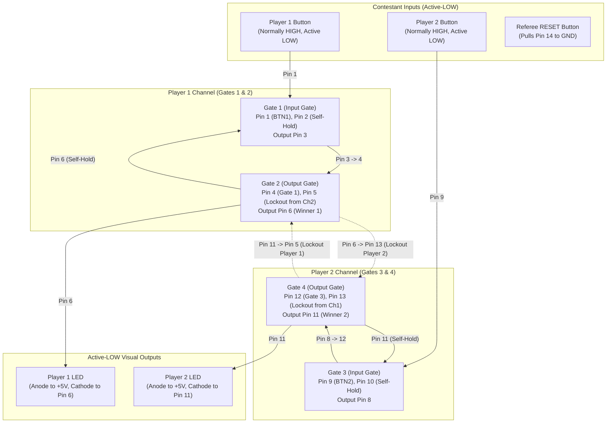
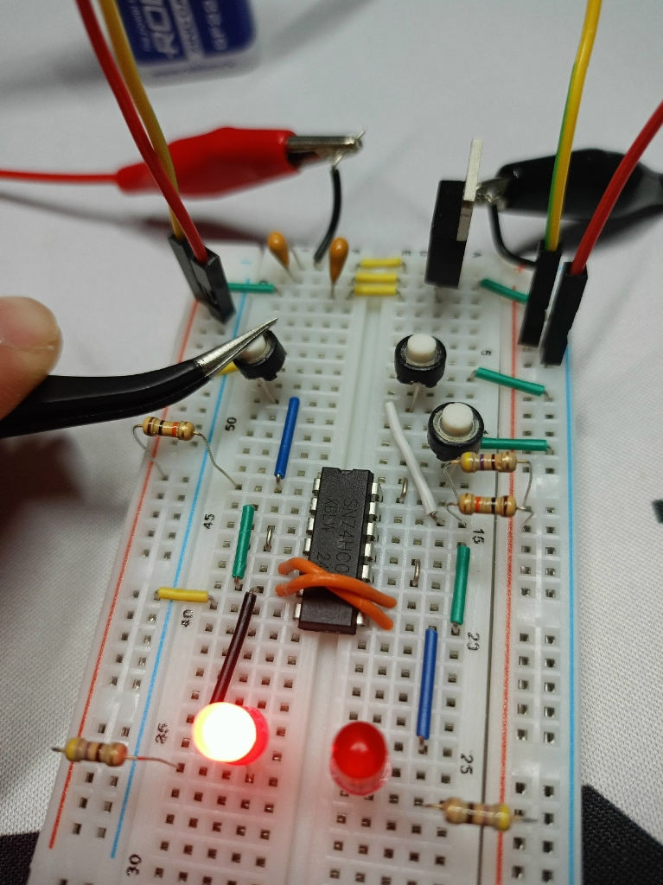
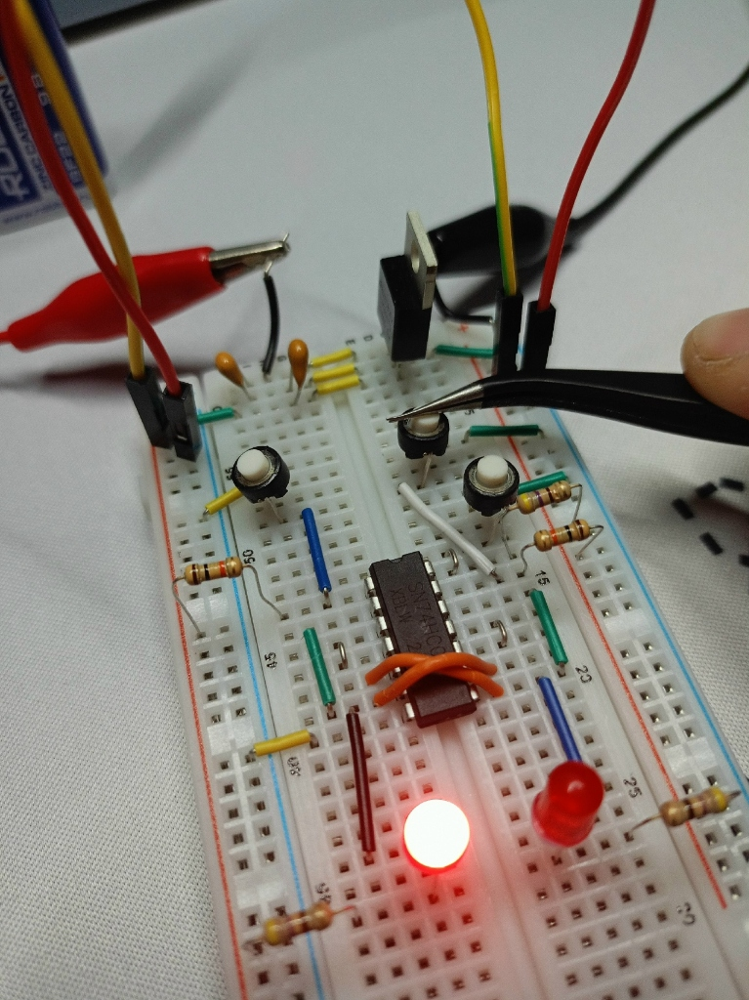
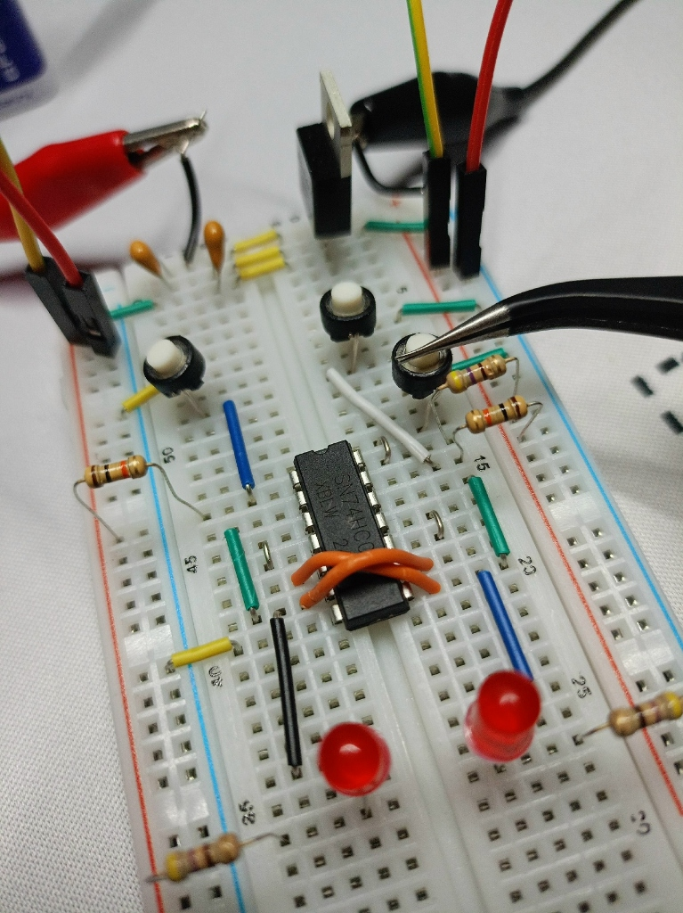
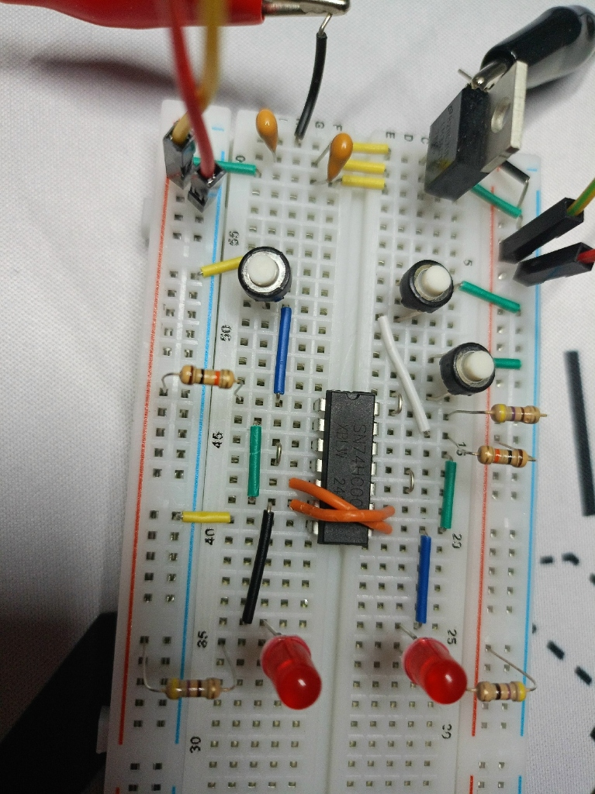

# ⚡ Project 09: Contestant Lockout Quiz Arbiter («Brain-Ring» on 74HC00 & 7805)

> High-speed asynchronous 2-channel priority arbiter (Contestant Lockout Bus Arbiter) implemented on a single `SN74HC00N` High-Speed CMOS IC (quad 2-input NAND) and an autonomous `L7805CV` linear power stage. Demonstrates hardware race-condition resolution, nanosecond-priority latching, mutual cross-coupled interlock (`Active-LOW`), dominant-zero gate blocking, and resistive power-drop hardware reset.

---

## 📋 Components Bill of Materials

| Component | Qty | Value / Specs | Purpose |
| :--- | :---: | :--- | :--- |
| `Logic IC` | 1 | `SN74HC00N` (DIP-14) | Quad 2-input NAND gates (High-Speed CMOS) |
| `Linear Voltage Regulator` | 1 | `L7805CV` (TO-220) | Regulates raw $+9\text{V}$ battery to clean $+5.0\text{V}$ |
| `Input Decoupling Capacitor` | 1 | `0.47 µF` (ceramic code `474`) | Filters input lead inductance and battery ripple |
| `Output Decoupling Capacitor`| 1 | `0.1 µF` (ceramic code `104`) | Prevents regulator HF oscillation |
| `Contestant Buttons` | 2 | 4-pin tactile switches | Active-LOW player triggers (commute input to GND) |
| `Pull-up Resistors` | 2 | `10 kΩ`, 0.25W | Maintain solid logic `1` ($+5\text{V}$) on idle inputs |
| `LED Ballast Resistors` | 2 | `330 Ω`, 0.25W | Current limiting for Active-LOW LEDs ($\approx 10\text{ mA}$) |
| `Reset Ballast Resistor` | 1 | `330 Ω`, 0.25W | Current limiter on Pin 14 ($V_{CC}$) for safe power-drop reset |
| `Reset Button` | 1 | 4-pin tactile switch | Hardware reset (pulls Pin 14 to GND) |
| `Indicator LEDs` | 2 | 5mm (Red / Green) | Visual feedback for winner status |
| `Primary Power Source` | 1 | 9V PP3 Alkaline Battery | Autonomous DC lab supply |
| `Prototyping Platform` | 1 | Solderless Breadboard `MB-102` | Planar prototype assembly |

---

## ⚡ Circuit Architecture & Logic Interlock Diagram

The arbiter solves the classical bus arbitration problem: two asynchronous devices request a single resource simultaneously. The circuit consists of two mirror-symmetric channels (Channel 1: Gates 1 & 2; Channel 2: Gates 3 & 4). Each channel incorporates an input trigger gate and an output latch/lockout gate.

---

## 🔬 Core Physics & Operating Principles

### 1. Active-LOW Current Sinking (Inverse Drive)
In standard digital circuits, LEDs are wired Active-HIGH (Cathode to `GND`, Anode to gate output). In NAND-based arbitration, this is reversed:
* **Idle State:** Gate outputs are logic `1` ($+5\text{V}$). With Anodes tied to $+5\text{V}$, the potential difference across the LED is $\Delta U = 5\text{V} - 5\text{V} = 0\text{V}$. No current flows; LEDs are dark.
* **Winning State:** The winning gate output transitions to logic `0` ($0\text{V}$). The gate acts as a **current sink**: current flows from the $+5\text{V}$ rail, through the ballast resistor, through the LED, and into the low-side NMOS transistor inside the 74HC00 to ground ($\Delta U \approx 5\text{V} - U_f \approx 3\text{V}$).

### 2. Dominant Zero in NAND Gates
A 2-input NAND gate possesses a fundamental algebraic property:
$$\overline{A \cdot B} = \overline{A} + \overline{B}$$
If **any single input is held at logic `0`**, the output is **physically forced to logic `1`**, regardless of the other input. 

When Player 1 wins:
1. Output Pin 6 drops to `0` (LED 1 turns ON).
2. Pin 6 feeds directly into **Pin 13 (Gate 4 input)** of Player 2.
3. Because Pin 13 is `0`, Gate 4's output is permanently forced to `1`, meaning Player 2's LED cathode is locked at $+5\text{V}$ ($\Delta U = 0\text{V}$).
4. Even if Player 2 presses their button (pulling Pin 9 to `0`), Gate 3 produces a `1` on Pin 8/12, but Gate 4 ignores it completely because the dominant `0` on Pin 13 locks Gate 4 output at `1`. Lockout is absolute and hardware-enforced.

### 3. Self-Holding Feedback Loop (Memory Latch)
When Player 1 presses Button 1, Pin 1 becomes `0`, making Pin 3 equal `1`. Because Player 2 has not played, Pin 5 is `1`. With both inputs (Pins 4 and 5) at `1`, Gate 2 output Pin 6 drops to `0`. 
This `0` on Pin 6 loops back to **Pin 2 (Gate 1 input)**. Now, even when Player 1 **releases the button** (Pin 1 returns to `1`), Pin 2 remains `0`, keeping Pin 3 at `1`. The circuit memorizes the winner indefinitely.

### 4. Resistive Power-Drop Reset (Pin 14)
Because all 8 input pins of the DIP-14 package are dedicated to button sensing, self-hold, and cross-lockout, an external reset gate is not available. 
A hardware reset is engineered via the power rail of the IC:
* Pin 14 ($V_{CC}$) is powered through a $330\,\Omega$ series resistor from the $+5\text{V}$ rail.
* The `RESET` tactile button connects Pin 14 directly to `GND`.
* When pressed, the button creates a voltage divider: $+5\text{V}$ drops across the $330\,\Omega$ resistor, pulling Pin 14 down to $0\text{V}$. The internal CMOS gates are momentarily starved of power, discharging internal gate capacitances and collapsing the latch states back to the high-impedance idle state ($+5\text{V}$ outputs on power restoration).

---

## 🧪 Hardware Verification Scenarios

| Step | Action | State Channel 1 (Pin 6) | State Channel 2 (Pin 11) | LED 1 (P1) | LED 2 (P2) | System Status |
| :---: | :--- | :---: | :---: | :---: | :---: | :--- |
| **1** | Power-on / `RESET` release | `1` ($+5\text{V}$) | `1` ($+5\text{V}$) | **OFF** | **OFF** | Ready / Idle |
| **2** | Player 1 presses BTN1 | `0` ($0\text{V}$) | `1` ($+5\text{V}$) | **ON** | **OFF** | P1 registered as Winner |
| **3** | Player 1 releases BTN1 | `0` ($0\text{V}$) | `1` ($+5\text{V}$) | **ON** | **OFF** | Self-hold latch active |
| **4** | Player 2 presses BTN2 | `0` ($0\text{V}$) | `1` ($+5\text{V}$) | **ON** | **OFF** | **Rival locked out** (dominant 0 on Pin 13) |
| **5** | Referee presses `RESET` | Transients $\to 1$ | Transients $\to 1$ | **OFF** | **OFF** | Latches cleared to Ready |
| **6** | Player 2 presses BTN2 | `1` ($+5\text{V}$) | `0` ($0\text{V}$) | **OFF** | **ON** | P2 registered as Winner |
| **7** | Player 1 presses BTN1 | `1` ($+5\text{V}$) | `0` ($0\text{V}$) | **OFF** | **ON** | **Rival locked out** (dominant 0 on Pin 5) |

---

## 📸 Working Hardware Photos

### 1. Player 1 Victory (First Press Registered)

*Player 1 button pressed with tweezers: LED 1 turns ON and latches.*

### 2. Rival Hardware Lockout Verification

*Player 2 button pressed with tweezers while Player 1 is active: completely ignored, LED 2 remains OFF.*

### 3. Referee Hardware Reset

*RESET button pressed: Pin 14 drops to 0V, memory cleared, both LEDs return to dark Idle state.*

### 4. Planar Prototyping Layout

*Full MB-102 breadboard layout with L7805 regulator, SN74HC00N IC, and symmetric cross-coupling wiring.*

---

## 👤 Author
* **GitHub:** [@d1amantelz](https://github.com/d1amantelz)
* **Roadmap:** [Electronics Lab Overview](../README.md)
