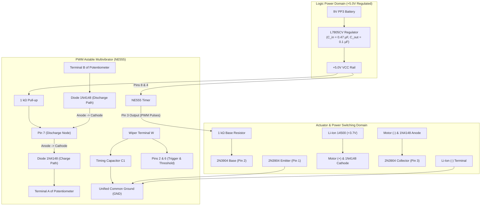
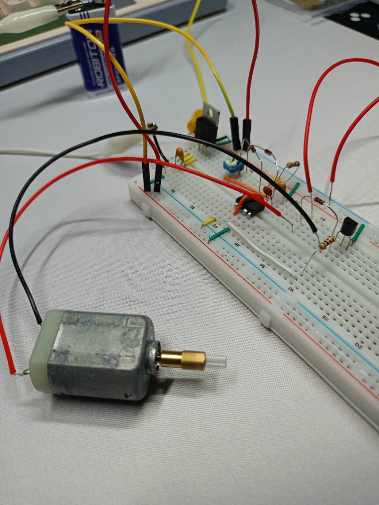
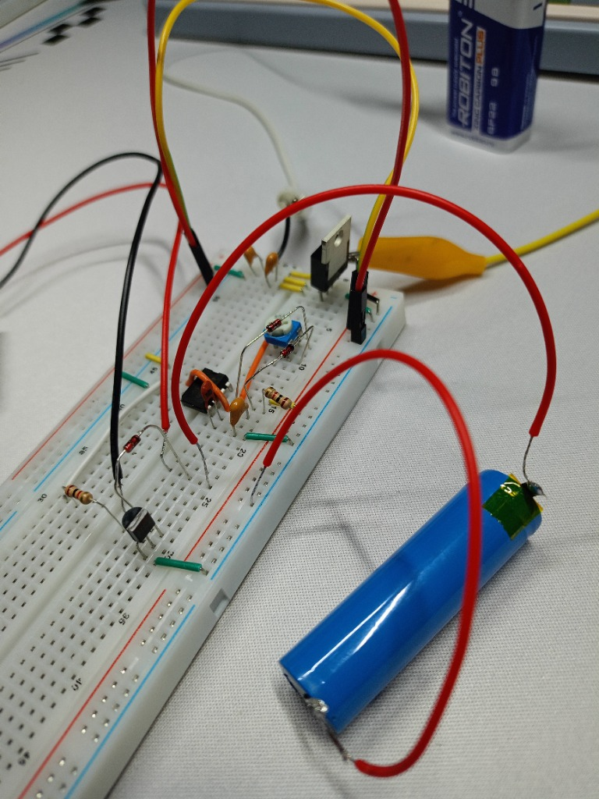
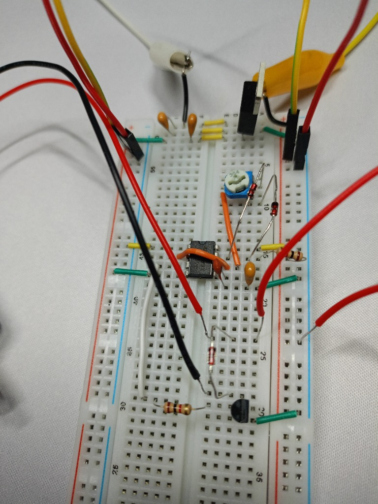
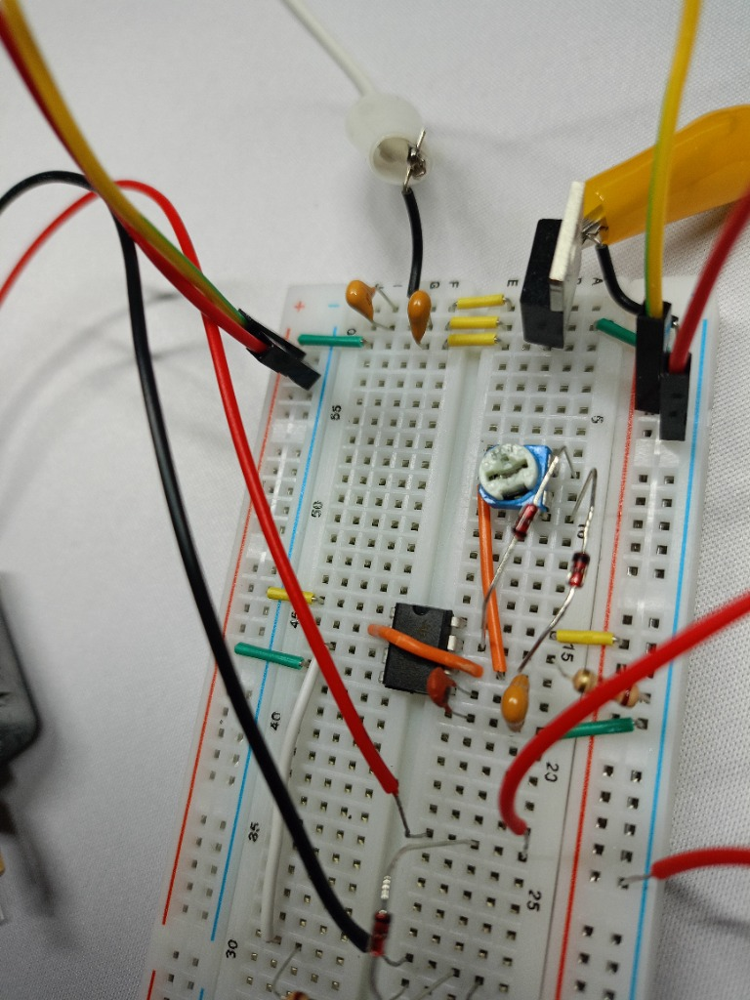

# ⚡ Project 10: PWM Motor Speed Controller & Inductive Power Switch (NE555 + 2N3904 + 1N4148)

> Solid-state Pulse Width Modulation (PWM) power actuator and DC motor driver built around an `NE555P` timer IC, a high-speed diode-steered timing network (`1N4148`), and a `2N3904` NPN BJT operating in saturated Low-Side switching mode. Features 1%–99% duty cycle modulation at a constant ~1 kHz carrier frequency, inductive counter-EMF suppression via a fast recovery flyback diode, and a dual-rail power topology with galvanically linked Common Ground (5V regulated logic vs 3.7V high-current Li-Ion traction battery).

---

## 📋 Components Bill of Materials

| Component | Qty | Value / Specs | Purpose |
| :--- | :---: | :--- | :--- |
| `Timer IC` | 1 | `NE555P` (DIP-8) | Precision astable multivibrator PWM carrier generator |
| `BJT Transistor` | 1 | `2N3904` (NPN, TO-92) | Saturated Low-Side power switch buffering motor current |
| `Fast Switching Diodes` | 3 | `1N4148` (DO-35, $t_{rr} = 4\,\text{ns}$) | 2x charge/discharge steering paths, 1x inductive Flyback clamp |
| `Potentiometer` | 1 | `10 kΩ – 100 kΩ` (trimpot) | Manual duty cycle modulation (1% to 99% pulse width) |
| `Base Current Limiter` | 1 | `1 kΩ`, 0.25W | Base saturation current driver ($I_B \approx 3.5\text{ mA}$) |
| `Discharge Pull-up` | 1 | `1 kΩ`, 0.25W | Current path for capacitor charging when Pin 7 is open |
| `Timing Capacitor C1` | 1 | `0.01 – 0.1 µF` (ceramic `103`/`104`) | Carrier frequency selection ($500\text{--}2000\,\text{Hz}$) |
| `Linear Voltage Regulator` | 1 | `L7805CV` (TO-220) | Regulates 9V input down to clean $+5.0\text{V}$ for 555 logic |
| `Filter Capacitors` | 2 | `0.47 µF` (in) / `0.1 µF` (out) | Power rail decoupling and regulator stability |
| `DC Motor` | 1 | Low-voltage DC commutator motor ($3\,\Omega$ DCR) | Inductive electromechanical dynamic load |
| `Power Sources` | 2 | 9V PP3 Battery + Li-Ion 14500 (3.7V, 600 mAh) | Isolated dual-rail logic & traction power supply |
| `Prototyping Platform` | 1 | Solderless Breadboard `MB-102` (Board #3) | Planar hardware assembly with Common Ground |

---

## ⚡ Circuit Architecture & Signal Flow

---

## 🔬 Core Physics & Operating Principles

### 1. Diode Steering & Full-Range Duty Cycle Modulation
In standard 555 astable configurations, the charge path ($R_1 + R_2$) is always larger than the discharge path ($R_2$), preventing duty cycles below 50%. 
* **Charge Phase (Pin 7 Floating):** Pin 7 is high-impedance. Current flows from $+5\text{V} \to 1\text{ kΩ} \to \text{Pin 7} \to \text{Diode 1} \to \text{Left pot segment } R_A \to \text{Wiper } W \to C_1$. Diode 2 is reverse-biased.
* **Discharge Phase (Pin 7 Grounded):** Pin 7 pulls to $0\text{V}$. The anode of Diode 1 drops to ground while its cathode is held at capacitor voltage ($+3.3\text{V}$), turning Diode 1 **hard OFF** and isolating the $+5\text{V}$ supply. Charge from $C_1$ flows through $\text{Wiper } W \to \text{Right pot segment } R_B \to \text{Diode 2} \to \text{Pin 7} \to \text{GND}$.
* Because $R_A + R_B = R_{pot} = \text{const}$, the switching frequency remains invariant while duty cycle smoothly modulates from ~1% to 99%.

### 2. Saturated BJT Switching & Low-Side Buffering
The `2N3904` operates strictly in saturation as a solid-state low-side switch:
$$I_B = \frac{V_{OH} - V_{BE}}{R_B} = \frac{4.5\text{V} - 0.7\text{V}}{1000\text{ }\Omega} \approx 3.8\text{ mA}$$
With an operational forced beta $\beta_{sat} \approx 20\text{--}50$, this delivers sufficient base overdrive to maintain $V_{CE(sat)} < 0.2\text{V}$ across nominal continuous motor currents ($80\text{--}150\text{ mA}$), eliminating linear power dissipation and thermal runaway.

### 3. Flyback Clamping (Lenz's Law Suppression)
The motor winding constitutes a dynamic inductor $L$. When the transistor abruptly closes, inductive energy resists current termination:
$$\mathcal{E} = -L \frac{di}{dt}$$
Without protection, collapsing flux creates an inductive kick exceeding $+60\text{--}100\text{V}$, causing avalanche breakdown of the BJT collector junction. The ultrafast `1N4148` diode ($t_{rr} = 4\text{ ns}$) is connected antiparallel to the motor terminals. When the transistor cuts off, the diode forward-biases, safely circulating inductive decay current in a closed loop through the coil winding and clamping the collector node at $V_{bat} + 0.7\text{V} \approx 4.4\text{V}$.

---

## 📸 Working Hardware Photos

### 1. Left Lateral View: DC Motor Actuator & Flexible Leads
*Commutator motor interfaced via flexible stranded pigtails to mechanically isolate breadboard spring leaves from rotor vibration:*

### 2. Right Lateral View: Li-Ion 14500 Traction Cell Interface
*Dedicated high-current 3.7V cell delivering peak inductive starting currents without brownout of the 5V logic supply:*

### 3. Planar Top-Down View: Complete Breadboard System
*Fully routed MB-102 prototype featuring 7805 regulator, 555 PWM timing block, 2N3904 switch, and unified Common Ground link:*

### 4. Macro View: Timing & PWM Steering Core
*Close-up inspection of dual 1N4148 steering diodes, precision trimpot, and ceramic timing tank capacitors:*

---

## 🛠️ Hardware Debugging & Bench Insights

1. **Linear Regulator Dropout Failure:** Powering the `L7805CV` directly from the $3.7\text{V}$ Li-Ion cell collapsed the output rail to $1.6\text{V}$ due to the regulator's $2.0\text{V}$ dropout voltage ($V_{in,\min} \ge 7.0\text{V}$). This starvation browned out the `NE555` (operating limit $\ge 4.5\text{V}$). **Fix:** Implemented an isolated dual-rail architecture: 9V battery into 7805 for logic, 3.7V Li-Ion directly into the motor, bridged by a Common Ground rail.
2. **Output Clamping from Unballasted LED:** A diagnostic test LED wired directly to Pin 3 clamped output voltage to $1.8\text{V}$ (diode forward threshold), starving the transistor base to $< 1\text{ mA}$. The motor acoustic coil whined at 1 kHz but lacked torque to turn. **Fix:** Removed the unballasted indicator; base drive restored to $3.8\text{ mA}$, achieving full rotor spin.
3. **Internal Resistance Mismatch:** Standard 9V alkaline PP3 batteries failed to start the $3\,\Omega$ winding due to high internal resistance ($R_{int} \approx 25\,\Omega$, stall demand $3\text{ A}$). **Fix:** Sourced motor current from the low-impedance 14500 Li-Ion cell, while retaining the 9V battery exclusively for low-current logic.
